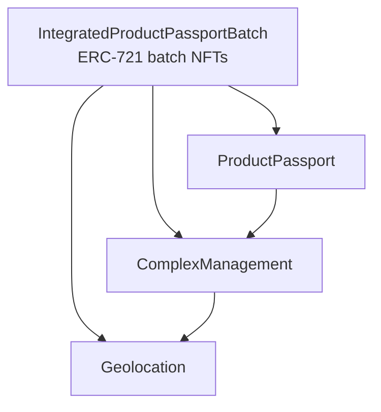

# Digital Product Passport — Smart Contracts

Solidity smart contracts for **Digital Product Passports (DPP)** on EVM-compatible blockchains, built with Hardhat 3 and OpenZeppelin Contracts 5. The goal of the project is to create a public reference implementation and, eventually, an EIP for on-chain product passports.

Published on npm as [`@digitalproductpassport/smartcontracts`](https://www.npmjs.com/package/@digitalproductpassport/smartcontracts).

## What is a Digital Product Passport?

A Digital Product Passport is a digital record that follows a product from design to disposal. It collects data about material sourcing, manufacturing, certifications and lifecycle events, and makes that data available to manufacturers, consumers, recyclers and repair services. A physical product links to its passport through an NFC chip, QR code or RFID tag.

Storing the passport on a blockchain makes the record tamper-evident and traceable. Large documents such as manuals and specifications are stored off-chain (for example on IPFS) and referenced by their content hash.

## Architecture

The system has four contracts. Each one is `Ownable`, so only the owner can write data.



| Contract | File | Purpose |
| --- | --- | --- |
| `Geolocation` | [contracts/Geolocation.sol](contracts/Geolocation.sol) | Stores locations (latitude, longitude, extra info) under a string ID. |
| `ComplexManagement` | [contracts/ComplexManagement.sol](contracts/ComplexManagement.sol) | Registers production sites ("complexes"): name, country, address, site type, industry, and a link to a geolocation. |
| `ProductPassport` | [contracts/ProductPassport.sol](contracts/ProductPassport.sol) | Stores product data: description, manuals and specifications (IPFS hashes), batch number, production and expiry dates, certifications, warranty, material composition (addresses of material passports), and the complex where the product was made. |
| `IntegratedProductPassportBatch` | [contracts/ExtendedProductPassport.sol](contracts/ExtendedProductPassport.sol) | Mints an ERC-721 token (`DPP`) for each production batch. Tracks amount, assembly time, transport details, and the batch's origin and current location. |
| `ProductPassportEchidnaTest` | [contracts/ProductPassportEchidnaTest.sol](contracts/ProductPassportEchidnaTest.sol) | Echidna fuzzing harness that checks product/complex/geolocation invariants. Test-only. |

### Data flow

1. **Geolocation**: a location is created with `setGeolocation(id, lat, lon, info)`.
2. **Complex**: `ComplexManagement.addComplex(...)` registers a site and stores its geolocation.
3. **Product**: `ProductPassport.createProduct(...)` creates a passport. The product must reference an existing complex.
4. **Batch**: `IntegratedProductPassportBatch.createBatch(...)` mints a batch NFT for an existing product. The batch's origin is taken from the product's complex.
5. **Tracking**: `updateBatchLocation(...)` moves the batch. `getBatchDetails(batchId, productId)` returns the batch, product, complex, and current and origin locations in one call. `setTokenURI` links the NFT to off-chain metadata (for example an IPFS JSON file).

### Wiring the contracts together

Each constructor takes an `initialOwner` address. After deployment, the contracts are linked like this (the Ignition module does it for you):

```solidity
complexManagement.setGeolocationContract(address(geolocation));
productPassport.setComplexManagement(address(complexManagement));
batchContract.initializeContracts(address(productPassport), address(complexManagement), address(geolocation));
geolocation.transferOwnership(address(complexManagement));
```

> **Ownership note:** `Geolocation.setGeolocation` is `onlyOwner`, and `ComplexManagement.addComplex` calls it, so `ComplexManagement` must own `Geolocation`. See [Project status](#project-status).

## Getting started

### Prerequisites

- Node.js 22.10 or later
- npm

### Install, build and test

```bash
git clone https://github.com/DigitalProductPassport/SmartContracts.git
cd SmartContracts
npm install
npx hardhat build
npx hardhat test
```

The toolchain:

| Tool | Version |
| --- | --- |
| Solidity compiler | 0.8.37 (contracts use `pragma solidity ^0.8.24`) |
| Hardhat | 3.x, with `@nomicfoundation/hardhat-toolbox-mocha-ethers` |
| OpenZeppelin Contracts | 5.6.x |
| ethers | 6.x |
| TypeScript tests | Mocha 12 + Chai 6 |

The project is an ES module (`"type": "module"`), as Hardhat 3 requires.

### Using the package in another project

```bash
npm install @digitalproductpassport/smartcontracts
```

```solidity
import "@digitalproductpassport/smartcontracts/contracts/ProductPassport.sol";
```

TypeChain bindings for ethers v6 are generated into [types/](types/) on every build:

```typescript
import { ProductPassport__factory } from "@digitalproductpassport/smartcontracts/types";
```

## Deployment

Contracts are deployed with [Hardhat Ignition](https://hardhat.org/ignition). The module in [ignition/modules/DigitalProductPassport.ts](ignition/modules/DigitalProductPassport.ts) deploys all four contracts, links them together, and transfers ownership of `Geolocation` to `ComplexManagement`.

```bash
# In-memory local network
npm run deploy:local

# Sepolia (also verifies the contracts on Etherscan)
npm run deploy:sepolia

# Any other configured network
npx hardhat ignition deploy ignition/modules/DigitalProductPassport.ts --network baseSepolia
```

### Configuration variables

Network secrets are read through Hardhat configuration variables. They are loaded only when a network that needs them is used, so tests run without any of them. Set them as environment variables, or store them encrypted in the Hardhat keystore:

```bash
npx hardhat keystore set DEPLOYER_PRIVATE_KEY
npx hardhat keystore set SEPOLIA_RPC_URL
```

| Variable | Used by |
| --- | --- |
| `DEPLOYER_PRIVATE_KEY` | All public networks |
| `SEPOLIA_RPC_URL` | `sepolia` |
| `BASE_SEPOLIA_RPC_URL` | `baseSepolia` |
| `AVALANCHE_FUJI_RPC_URL` | `avalancheFuji` |
| `ARBITRUM_SEPOLIA_RPC_URL` | `arbitrumSepolia` |
| `ETHERSCAN_API_KEY` | Contract verification |

### Networks

| Name | Network | Chain ID |
| --- | --- | --- |
| `default` | Local in-process simulated network | 31337 |
| `hardhatMainnet` | Local simulated L1 | 31337 |
| `sepolia` | Ethereum Sepolia | 11155111 |
| `baseSepolia` | Base Sepolia | 84532 |
| `avalancheFuji` | Avalanche Fuji | 43113 |
| `arbitrumSepolia` | Arbitrum Sepolia | 421614 |

## Scripts

| Command | Description |
| --- | --- |
| `npm run build` | Compile contracts and generate TypeChain types |
| `npm test` | Run the Mocha test suite |
| `npm run coverage` | Run tests with Hardhat's built-in coverage report |
| `npm run gas` | Run tests with per-function gas statistics |
| `npm run deploy:local` | Deploy the system to the local network with Ignition |
| `npm run deploy:sepolia` | Deploy to Sepolia and verify on Etherscan |
| `npm run prettier:check` / `prettier:write` | Check or apply formatting |
| `npm run security:slither` | Static analysis with Slither (writes `slither-report.json`) |
| `npm run security:mythril-single` | Symbolic analysis of `ProductPassport.sol` with Mythril |
| `npm run security:all` | Run Slither and Mythril |

Slither and Mythril are Python tools and must be installed separately (`pip install slither-analyzer mythril solc-select`).

### Fuzzing with Echidna

```bash
echidna contracts/ProductPassportEchidnaTest.sol --contract ProductPassportEchidnaTest --config echidna.yaml
```

The harness checks that every product references an existing complex and that its origin geolocation can be resolved.

## Continuous integration

[.github/workflows/ci.yml](.github/workflows/ci.yml) runs on pushes and pull requests to `main`:

- **build**: production build, solhint, tests with coverage, Slither, Echidna and Mythril. Reports are uploaded as the `security-reports` artifact.
- **gas-reporter**: runs the tests with gas statistics.
- **publish** (pushes to `main` only): sets the patch version to the run number, creates a GitHub release, and publishes the package to npm.

## Project status

The project is a work in progress. Known limitations:

- `Geolocation` can only have one owner. The deployment gives it to `ComplexManagement`, so `IntegratedProductPassportBatch.updateBatchLocation` can move a batch only to a geolocation that already exists. Creating a new location from that function reverts.
- `Geolocation` validates coordinates only by string length, not by numeric range.
- The docs in [docs/](docs/) were generated for an older version of the contracts and are not regenerated automatically.

## Contributing

Contributions are welcome:

1. Fork the repository.
2. Create a feature branch.
3. Make your changes and run `npm test`.
4. Open a pull request that describes the change.

## License

MIT. See [LICENSE](LICENSE).
